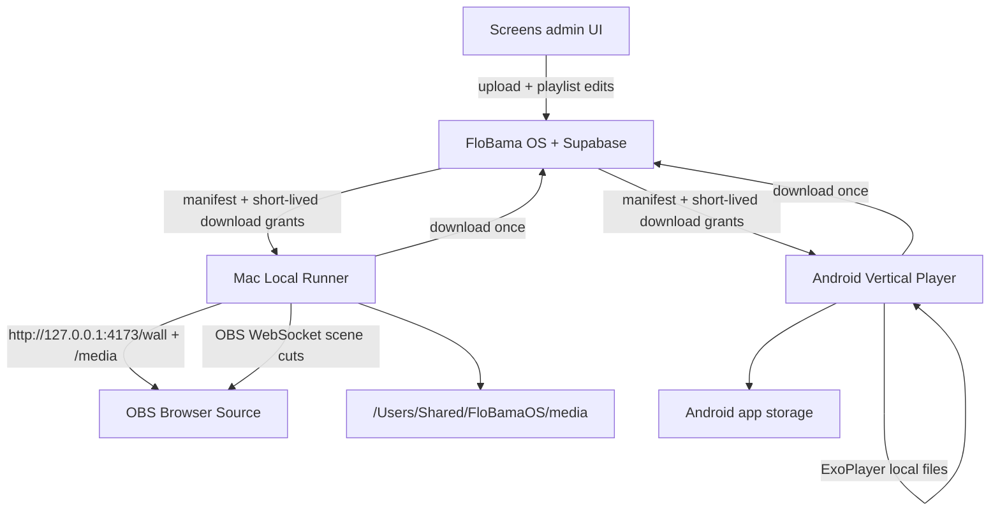

# FloBama Local Media Architecture

**Status:** Planning document (no production changes).  
**Audience:** Engineering implementation in Cursor after architecture approval.  
**Related:** [mac-local-runner-plan.md](./mac-local-runner-plan.md), [android-vertical-player-plan.md](./android-vertical-player-plan.md), [media-sync-api-contract.md](./media-sync-api-contract.md), [bandwidth-optimization-plan.md](./bandwidth-optimization-plan.md), [display-migration-checklist.md](./display-migration-checklist.md), [local-media-implementation-roadmap.md](./local-media-implementation-roadmap.md)

---

## 1. Problem statement

FloBama OS stores roughly **2.24 GB** of media in the public Supabase Storage bucket `screen-ads`, yet the View 360 Marketing organization consumed **395.14 GB** of cached egress against a **275 GB** allowance. Inspected Supabase edge logs showed:

- ~115 GB transferred to an OBS Studio client in the inspected window
- Two MP4 assets responsible for ~119 GB of outbound traffic
- Large volumes of HTTP **206 Partial Content** responses (video range requests)
- More than 1.5 million edge-log records in the inspected window
- Elevated HTTP 5xx on the LED wall sync endpoint during Supabase service restrictions

**Goal:** Preserve remote control, OBS scene switching, playlists, takeovers, trivia/audience overlays, and admin workflows — while moving continuous playback traffic off Supabase onto local device caches.

---

## 2. Audit of current architecture (repository as source of truth)

### 2.1 Media lifecycle today

```
Upload (browser)
  → supabase.storage.from("screen-ads").upload(...)
  → getPublicUrl(storagePath)   // public HTTPS URL, no signed URLs in app
  → DB row (screen_ads | led_wall_scenes | menu_specials | audience_*)
  → Playlist / runtime tables
  → Public poll APIs (no-store JSON)
  → Browser <video>/
  → Repeated Storage Range requests on every seek, loop, and remount
```

### 2.2 Display surfaces

| Surface | Route / client | Poll | Media source |
|---------|----------------|------|--------------|
| LED wall (OBS Browser Source) | `/display/led` + `LedDisplay` | 1s JSON + 250ms playlist index | Public `screen-ads` URLs |
| Vertical TVs | `/display/vertical` + `VerticalPlayer` | 4s JSON | Public `screen-ads` URLs |
| Lower third | `/overlay` | 10s | Now-playing text only (not ad media) |
| Staff wall login | `/wall` | — | Redirects to `/screens` (not a player) |

### 2.3 OBS integration (confirmed)

- Booth agent: `clients/led-obs/index.mjs` — POSTs OBS snapshot to `/api/agent/v1/led-wall/sync` every **1 second**, then `SetCurrentProgramScene` when desired scene differs.
- Agent **never downloads media**. It only cuts OBS scenes.
- Media OBS scene hosts a Browser Source pointed at `{origin}/display/led`.
- Staff ObsPanel in booth UI is orphaned; production cuts are agent-driven.

### 2.4 Storage and uploads (confirmed)

- Bucket `screen-ads` is **public**; app uses `getPublicUrl` exclusively (zero `createSignedUrl`).
- Paths: `{venueId}/…`, `{venueId}/led/…`, `{venueId}/led/artists/…`, `{venueId}/specials/…`, `{venueId}/audience/…`.
- No content-hash columns; playlist “revision” strings are change-detection only.
- Full page reloads: vertical revision changes, takeover end, staff `reload_nonce` bump.

### 2.5 Device auth today

| Device | Pattern |
|--------|---------|
| LED booth Mac | Admin-issued Bearer token hashed in `led_wall_agent_secrets` |
| Mac Camera | Pairing code → long-lived hashed device token (`camera_connector_*`) |
| Vertical TVs | **None** — anyone who can open `/display/vertical` sees the playlist |

### 2.6 What does not exist

- Local media cache on Mac or TV
- Android APK / WebView kiosk shell
- Signed download grants for display devices
- Offline-first playlist activation
- Service worker / IndexedDB media cache
- LaunchAgent for LED OBS (camera connector has one)

### 2.7 Confirmed vs hypothesis

| Claim | Status |
|-------|--------|
| Agent sync does not download media bytes | **Confirmed** |
| Browser Sources stream public Storage URLs | **Confirmed** |
| Vertical `location.reload()` on revision/nonce re-fetches media | **Confirmed** |
| LED playlist advance remounts `<video>` and may re-request `src` | **Confirmed** |
| Browser/CDN caching reduces some repeats | **Hypothesis** (runtime); measured egress shows it is insufficient for looping Range traffic |
| Docs describing browser-held OBS credentials as the live cut path | **Stale** (`docs/flobama-os-v1.html`) |

---

## 3. Target architecture

### 3.1 Principle

**FloBama OS remains the control plane.** Display devices become **local media planes**.

- Control: scene, playlist, order, schedules, takeovers, trivia/audience state → small JSON over HTTPS.
- Media: download once when assigned → verify → play from local disk forever until content hash changes.

### 3.2 High-level data flow



### 3.3 Playback decision: Option A (local wall player)

**Primary recommendation:** OBS Browser Source points to:

```text
http://127.0.0.1:4173/wall
```

| Option | Description | Verdict |
|--------|-------------|---------|
| **A — Local wall player** | Runner serves player HTML/JS + cached media on localhost | **Adopt** |
| B — Hosted player + local media | OBS keeps `https://…/display/led` but media `src` → localhost | **Reject for production** |

**Why A over B**

1. **Mixed content:** Hosted HTTPS pages cannot load `http://127.0.0.1` media in modern CEF/Chromium.
2. **Private Network Access / CORS:** OBS Browser Source requesting LAN/localhost from a public origin is fragile and version-dependent.
3. **Reliability:** Local origin owns both UI and media; no third-party network path on every frame.
4. **Egress:** Playback Range requests never leave the Mac.

**Local `/wall` behavior**

- Poll FloBama public (or device-auth) APIs for LED control JSON, trivia wall, audience wall (lightweight).
- Map each media asset id → `http://127.0.0.1:4173/media/{assetId}`.
- Preserve overlay precedence from `LedDisplay`: trivia > audience tool > playlist > audience lobby > single media > black.
- Shared playlist cursor remains time-based (`ledPlaylistIndexAt` + `activated_at`) so OBS cuts and local player stay aligned.
- Operator **never** edits media file paths in OBS after uploads.

**Small overlay assets** (brand logos, corner sponsors) may still load from FloBama/Supabase during Phase 1 if they are kilobyte-scale; prefer caching them in a later phase. Large MP4/PNG loops **must** be local.

### 3.4 Mac Local Runner (summary)

Single background process succeeding `clients/led-obs`:

1. OBS WebSocket sync (existing responsibility)
2. Persistent media cache + integrity checks
3. Localhost HTTP server (range/206, MIME, traversal-safe)
4. Menu-bar status + LaunchAgent KeepAlive

Details: [mac-local-runner-plan.md](./mac-local-runner-plan.md)

### 3.5 Android Vertical Player (summary)

Installable APK using Media3/ExoPlayer, device pairing, offline cache, immersive kiosk mode. Reuses shared manifest API. Details: [android-vertical-player-plan.md](./android-vertical-player-plan.md)

### 3.6 Shared device / manifest plane

Conceptual agent namespace:

```text
/api/agent/v1/display-devices/
```

- Pairing, heartbeat, revision-based manifest, authorized download grants, status reports, revocation.
- Asset identifiers and storage paths are **not** authorization.
- Contract: [media-sync-api-contract.md](./media-sync-api-contract.md)

---

## 4. Local storage approach

### 4.1 Mac paths

| Path | Purpose |
|------|---------|
| `/Users/Shared/FloBamaOS/media/blobs/{sha256}` | Content-addressed media files |
| `/Users/Shared/FloBamaOS/media/tmp/` | Partial downloads |
| `/Users/Shared/FloBamaOS/media/cache.sqlite` | Asset index, playlist pins, download state |
| `~/Library/Application Support/FloBama Local Runner/` | Config, status.json, logs symlink |
| `~/Library/Logs/FloBamaLocalRunner/` | Rotating diagnostic logs |

`/Users/Shared/…` survives user switches and is readable by the OBS process / Browser Source via the local HTTP server (not by direct filesystem paths in OBS).

### 4.2 Index: SQLite (not JSON-only)

**Recommendation: SQLite** for the cache index.

| Need | SQLite | Flat JSON |
|------|--------|-----------|
| Concurrent read while downloading | Strong | Fragile |
| Query by sha256 / asset id / last_used | Native | Manual |
| Atomic state transitions | Transactions | Rewrite whole file |
| Status snapshot for menu bar | Export `status.json` | Possible but weaker as sole store |

Schema sketch:

```sql
CREATE TABLE assets (
  asset_id TEXT PRIMARY KEY,
  version INTEGER NOT NULL,
  sha256 TEXT NOT NULL,
  size_bytes INTEGER NOT NULL,
  media_type TEXT NOT NULL,
  path TEXT NOT NULL,
  state TEXT NOT NULL, -- pending|downloading|ready|corrupt|retired
  pinned INTEGER NOT NULL DEFAULT 0, -- currently in active playlist
  last_used_at TEXT,
  created_at TEXT NOT NULL,
  verified_at TEXT
);

CREATE TABLE manifest_meta (
  key TEXT PRIMARY KEY,
  value TEXT NOT NULL
);
```

### 4.3 Android storage

- Application-specific external/internal storage under app sandbox.
- Room or SQLite mirror of the same asset index concepts.
- Content-addressed files by sha256.
- Atomic playlist activation: stage → verify all → flip active revision pointer.

### 4.4 Cache lifecycle rules

1. Download to `tmp/` with resume (Range) and exponential backoff.
2. Verify sha256 before rename into `blobs/`.
3. Never delete an asset that is `pinned` or currently playing.
4. Enforce capacity limit; LRU-evict unreferenced, unpinned, non-playing assets.
5. On corrupt verify failure: mark corrupt, re-queue download, keep last-known-good if still present under previous hash.
6. Report cache health (bytes used, asset counts, download progress, errors) to FloBama OS.

---

## 5. Synchronization strategy

| Channel | Interval | Payload |
|---------|----------|---------|
| OBS / scene heartbeat | 2–5s (tunable; start 2s) | OBS snapshot + desired scene (existing sync semantics) |
| Manifest check | On heartbeat response `revision` change, or `If-None-Match` | Full manifest only when changed (304 otherwise) |
| Media download | Background when manifest adds/changes assets | Authorized URL, once per hash |
| Status report | Every 30–60s or on state change | Cache health, playback, errors |

**Do not** re-query full playlist DB every second when nothing changed. Return `revision` + `ETag` from FloBama; clients send prior revision.

**Last-known-good:** If FloBama or Supabase is unavailable, continue playing the last validated local playlist. Never blank the wall solely because sync failed.

---

## 6. FloBama OS changes (additive)

Preserve: Screens admin, playlists, takeovers, LED scenes, trivia, audience, cron automation, public `/display/*` for rollback.

Add:

1. Display device registry + pairing + revocation (patterned on camera connector).
2. Media content hash / size columns (or side table) + backfill job.
3. Manifest + download-grant APIs under `/api/agent/v1/display-devices/`.
4. Staff UI panels for device online/offline, download progress, software version.
5. Optional transfer metrics + bandwidth budget alerts.

Public `/display/led` and `/display/vertical` remain until migration stages complete.

---

## 7. Fallback strategy

| Failure | Behavior |
|---------|----------|
| Internet down | Play last-known-good local playlist; queue sync |
| Supabase Storage 5xx | Do not retry-storm; backoff; keep local playback |
| Missing file for new playlist | Hold previous playlist until all assets ready |
| Corrupt file | Quarantine hash; re-download; if playing, finish current if possible then skip |
| Expired device credentials | Keep local playback; surface “re-pair required” in staff UI and menu bar; stop new downloads |
| Stale device assignment | Continue last assignment until new manifest validated |
| Disk full | Stop new downloads; alert; never delete active pins |
| Local HTTP server crash | LaunchAgent restarts runner; OBS may show black briefly — log + auto-recover |
| OBS disconnected | Runner keeps cache warm; reconnect WebSocket with backoff |

---

## 8. Security posture (architecture-level)

- No Supabase **service-role** keys in Mac app or APK.
- Device tokens: random, shown once, stored hashed server-side (camera pattern).
- Download grants: short-lived, device-scoped, asset-scoped.
- Local media server: bind `127.0.0.1` by default; reject path traversal; no directory listing.
- Revoke lost devices immediately from Screens admin.
- Logs: no full tokens; rotate; retain ~14–30 days locally.
- Software updates: signed DMG/APK distribution via FloBama downloads UI.

Full assessment: see roadmap security section and API contract.

---

## 9. Success criteria

1. Steady-state LED and vertical playback generate **near-zero** Supabase Storage bytes (control JSON only).
2. New media downloads once per device when assigned; unchanged hashes never re-download.
3. OBS scene switching remains staff-controlled with low latency.
4. Offline booth/kiosk continues last-known-good content.
5. Org monthly cached egress trending toward **≤ 75 GB** with headroom (see bandwidth plan).
6. Rollback to hosted `/display/*` remains one OBS URL change / one APK config switch away during migration.

---

## 10. Explicit non-goals

- Rebuilding FloBama OS or the Screens dashboard.
- Replacing playlist/ad administration.
- Removing Supabase or OBS.
- Making Mac runner depend on an open Terminal.
- Making kiosk playback depend on continuous internet.
- Assuming Android Device Owner / MDM without hardware verification.
